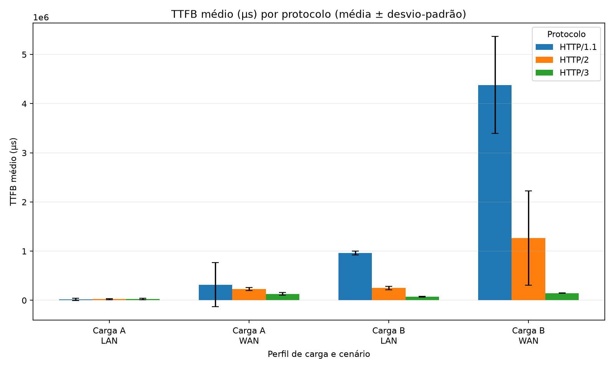
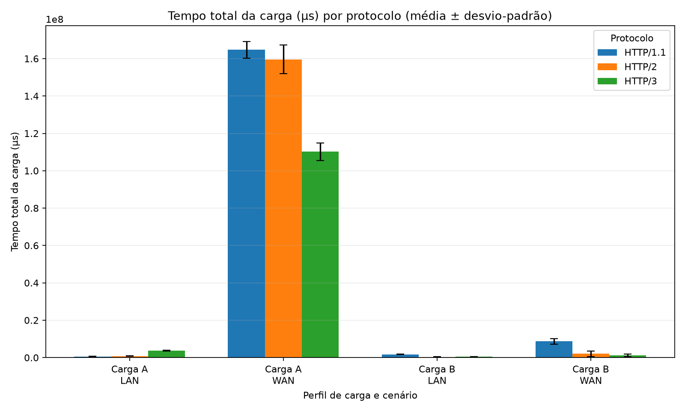
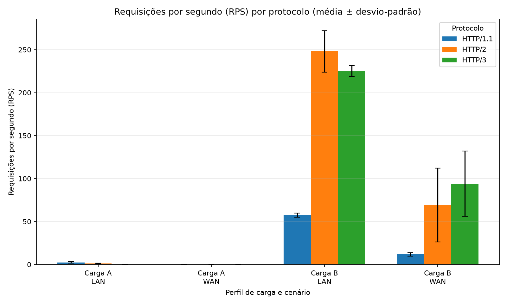

# Relatório Técnico — Desempenho de HTTP/1.1, HTTP/2 e HTTP/3

**Instituição:** UFPI / CSHNB — Redes II
**Trabalho:** Segunda Avaliação — Estudo Experimental de Desempenho de Protocolos Web
**Integrante:** Kleber Moura de Jesus
**Data das execuções:** 20 de outubro de 2026
**Vídeo de apresentação (15 minutos):** link a inserir pelo autor antes da submissão

> As duas execuções completas estão registradas na seção 3.4. Os resultados são medições
> deste ambiente experimental e não devem ser substituídos por valores esperados ou simulados.
> Falta inserir o link do vídeo e completar os dados bibliográficos da edição do livro adotada
> na disciplina antes da submissão.

## Resumo

Este trabalho compara HTTP/1.1 sobre TCP, HTTP/2 protegido por TLS 1.3 sobre TCP e HTTP/3
sobre QUIC em dois cenários de rede emulados. São avaliadas a transferência de um objeto de
50 MB e a transferência de 100 objetos de 10 KB, com cinco ou mais repetições por teste.
O cliente registra latência até o primeiro byte do corpo, duração de cada resposta, duração
total da carga, vazão em requisições por segundo (RPS), percentis p50/p99 e bytes recebidos.
Foram realizadas duas rodadas completas de T01–T12, com cinco repetições por teste. Os
resultados são apresentados por rodada, com suas limitações de implementação e variabilidade.

**Palavras-chave:** HTTP/1.1; HTTP/2; HTTP/3; QUIC; TCP; desempenho; `tc netem`.

## 1. Introdução

HTTP/1.1, HTTP/2 e HTTP/3 oferecem semânticas de aplicação semelhantes, mas diferem no
transporte, no estabelecimento seguro de conexão e na multiplexação. Essas decisões podem
alterar a latência de início, a vazão e a cauda da distribuição de latência, sobretudo quando há
RTT alto e perda de pacotes. O objetivo deste estudo é medir essas diferenças de maneira
reprodutível, mantendo fixos os perfis de conteúdo e a emulação do caminho.

O experimento não presume que um protocolo será sempre superior. A interpretação deve
distinguir custo de handshake, transferência de um objeto grande, concorrência de objetos
pequenos, implementação concreta dos servidores e variação entre repetições.

## 2. Fundamentação teórica

### 2.1 HTTP/1.1 e HTTP/2 sobre TCP

HTTP/1.1 utiliza TCP e, neste ensaio, não utiliza TLS. Uma conexão TCP nova exige o
estabelecimento do transporte antes da troca de dados da aplicação. O ensaio de carga A
abre uma conexão nova por amostra para que a latência inicial inclua esse custo. Para a carga
B, o cliente mantém uma conexão persistente; HTTP/1.1 não multiplexa respostas independentes
no mesmo canal como HTTP/2, e o limite de uma conexão no pool deixa visível a serialização
das respostas.

HTTP/2 mantém a semântica de HTTP sobre TLS 1.3/TCP e multiplexa streams por quadros na
mesma conexão. Isso elimina o bloqueio de aplicação próprio da sequência de respostas do
HTTP/1.1, mas não elimina a entrega ordenada do TCP. Uma perda de segmento pode atrasar a
entrega dos bytes subsequentes da conexão, inclusive bytes pertencentes a outros streams.

### 2.2 TCP CUBIC — Tanenbaum §6.5.11

TCP CUBIC ajusta a janela de congestionamento usando uma função cúbica do tempo desde o
último evento de congestionamento. Após detectar perda, o algoritmo reduz a janela e tenta
retomar o crescimento de forma mais rápida perto do valor de janela anterior, mantendo uma
curva de crescimento mais suave quando se afasta daquele ponto. Em uma WAN emulada com
perdas estocásticas, perdas repetidas podem provocar novas reduções antes de a janela recuperar
o nível necessário para preencher o caminho. O RTT também aumenta o tempo necessário para
receber confirmações e retransmitir dados. A consequência esperada é a redução da vazão TCP
útil em T04 e T05, não porque a cifragem TLS altere o algoritmo CUBIC, mas porque ambos
dependem de TCP e enfrentam a mesma perda do caminho. A magnitude dessa diferença é
resultado experimental e deve ser obtida dos dados.

Essa interpretação depende da implementação e do sistema operacional do servidor que envia
os dados. O comportamento de controle de congestionamento não pode ser atribuído apenas ao
cliente HTTP nem inferido da porcentagem nominal de perda; deve ser tratado como uma
explicação compatível com o mecanismo TCP observado.

### 2.3 QUIC e BBR — Tanenbaum §§6.6.1–6.6.2

QUIC integra TLS 1.3 ao estabelecimento de transporte sobre UDP e oferece streams
independentes. Diferentemente da entrega ordenada global do TCP, a perda de dados de um
stream QUIC não exige que dados já recebidos de outros streams aguardem a retransmissão
daquele stream. Essa propriedade reduz o HoL blocking entre streams de HTTP/3, mas não
elimina bloqueios dentro do mesmo stream, nem perdas, retransmissões ou contenção de
congestionamento compartilhado pela conexão.

O BBR estima a largura de banda do gargalo e o RTT mínimo para controlar o ritmo de envio,
em vez de usar cada perda isolada como único sinal de congestionamento. Esse princípio pode
ajudar a explicar resiliência em enlaces com perdas não necessariamente causadas por
congestionamento. Contudo, QUIC não implica que BBR esteja ativo: o algoritmo selecionado
depende da implementação do servidor QUIC. Portanto, só se deve atribuir desempenho de
T06/T09/T12 ao BBR se a configuração e a versão do Caddy/quic-go utilizadas confirmarem essa
escolha. Sem essa confirmação, a análise deve atribuir o resultado às propriedades verificáveis
de QUIC/HTTP/3 e registrar o algoritmo de congestionamento como uma variável da
implementação, não como fato presumido.

## 3. Metodologia

### 3.1 Ambiente e controle experimental

O ambiente é composto por Nginx servindo HTTP/1.1 e HTTP/2 com TLS 1.3, Caddy servindo
HTTP/3/QUIC e um cliente Python assíncrono. Os quatro contêineres pertencem à rede bridge
`172.20.0.0/16`. O cliente também está na bridge para que o atraso configurado em sua saída
e na saída dos servidores forme o caminho de ida e volta. Na LAN aplica-se 0,5 ms em cada
sentido e nenhuma perda. Na WAN aplicam-se 25 ms de atraso em cada sentido e 2% de perda
somente na saída dos servidores, evitando somar duas taxas de perda de 2%.

O runner gera um certificado autoassinado de laboratório com SAN para os nomes dos serviços,
gera objetos com bytes pseudoaleatórios para reduzir efeitos de compressibilidade, constrói e
inicia os contêineres, executa a matriz, salva os dados, gera os gráficos e remove os
contêineres e as disciplinas `tc`. O certificado é confiável pelo cliente via arquivo de CA; o
teste de HTTPS não desativa a validação do certificado.

Na carga A, cada amostra cria e fecha uma sessão de cliente/conexão antes da próxima medição.
Assim, o TTFB inclui o estabelecimento de TCP/TLS ou QUIC. Na carga B, cada repetição mantém
uma única conexão de transporte por protocolo, e os 100 pedidos são submetidos concorrentemente
por essa conexão. HTTP/1.1 é limitado a uma conexão e serializa as respostas; HTTP/2 e HTTP/3
podem multiplexar streams. O cliente solicita `no-cache` e `no-store`, não implementa cache,
e os servidores enviam `Cache-Control: no-store`.

Cada teste tem cinco repetições. Os gráficos exibem média e desvio-padrão entre repetições.
Nos arquivos `summary.md` e `summary.csv`, média, mediana e desvio-padrão de TTFB são
calculados sobre as cinco médias por amostra; p50 e p99 de TTFB e duração individual são
calculados sobre os registros de requisições. Para Carga B, há 500 observações individuais por
teste (100 requisições em cada uma de cinco repetições). Para Carga A, há somente cinco
observações individuais por teste, portanto seus percentis empíricos são pouco precisos. RPS e
tempo total da carga são estatísticas das cinco amostras agregadas.

### 3.2 Matriz executada

| Teste | Carga | Protocolo | Rede | Questão observada |
|---|---|---|---|---|
| T01 | 1 × 50 MB | HTTP/1.1 | LAN | Vazão TCP sem perda em caminho de baixa latência |
| T02 | 1 × 50 MB | HTTP/2 + TLS 1.3 | LAN | Custo de TLS e desempenho de TCP cifrado |
| T03 | 1 × 50 MB | HTTP/3 | LAN | Transferência QUIC em caminho sem perda |
| T04 | 1 × 50 MB | HTTP/1.1 | WAN | Sensibilidade de TCP a RTT e perda |
| T05 | 1 × 50 MB | HTTP/2 + TLS 1.3 | WAN | TCP/TLS sob RTT e perda |
| T06 | 1 × 50 MB | HTTP/3 | WAN | Transferência QUIC sob RTT e perda |
| T07 | 100 × 10 KB | HTTP/1.1 | LAN | Serialização e latência da carga concorrente |
| T08 | 100 × 10 KB | HTTP/2 + TLS 1.3 | LAN | Multiplexação HTTP/2 |
| T09 | 100 × 10 KB | HTTP/3 | LAN | Multiplexação de streams QUIC |
| T10 | 100 × 10 KB | HTTP/1.1 | WAN | Efeito de RTT/perda sobre respostas serializadas |
| T11 | 100 × 10 KB | HTTP/2 + TLS 1.3 | WAN | Efeito de perda TCP sobre streams multiplexados |
| T12 | 100 × 10 KB | HTTP/3 | WAN | Streams QUIC independentes sob perda |

### 3.3 Métricas e processamento

O TTFB registrado é o intervalo, em microssegundos, desde o início do pedido até o primeiro
byte do corpo da resposta. Ele inclui estabelecimento de conexão nos testes frios. O tempo de
resposta individual mede até o último byte do objeto; o tempo total da carga mede a janela
completa da amostra. RPS é o total de respostas bem-sucedidas dividido por essa janela. Os
percentis p50 e p99 são calculados sobre tempos individuais de resposta dentro de cada amostra.
As médias, medianas e desvios-padrão da tabela consolidada são calculados sobre as repetições
independentes de cada teste.

### 3.4 Registro das execuções

Foram realizadas duas execuções completas em 20 de outubro de 2026. Cada rodada contém cinco
repetições para cada um dos 12 testes (60 amostras agregadas por rodada), além dos registros
brutos por requisição.

| Rodada | Identificador | Cobertura | Dados brutos | Resumo e gráficos |
|---|---|---|---|---|
| 1 | `20261020T194130Z-578` | T01–T12, 5 repetições/teste | [`results.json`](./results/20261020T194130Z-578/results.json), [`results.csv`](./results/20261020T194130Z-578/results.csv) | [`plots/`](./results/20261020T194130Z-578/plots/) |
| 2 | `20261020T205948Z-881` | T01–T12, 5 repetições/teste | [`results.json`](./results/20261020T205948Z-881/results.json), [`results.csv`](./results/20261020T205948Z-881/results.csv) | [`plots/`](./results/20261020T205948Z-881/plots/) |

Os identificadores incluem o horário UTC usado pelo runner; os diretórios e arquivos de cada
rodada foram preservados separadamente. As rodadas são reportadas individualmente, sem
combinar as amostras nem selecionar apenas a rodada com resultado mais favorável. As diferenças
entre rodadas são apresentadas como variação observada entre execuções, não como uma nova
estimativa estatística independente de dez repetições.

## 4. Resultados

As tabelas estatísticas completas e os gráficos das duas rodadas estão nos diretórios
registrados na seção 3.4. Os gráficos apresentam média e desvio-padrão entre as cinco
repetições. A tabela abaixo compara algumas métricas agregadas selecionadas; os números após
`±` são desvios-padrão entre repetições, não intervalos de confiança.

| Teste e métrica | Rodada 1 | Rodada 2 |
|---|---:|---:|
| T03 — tempo total da carga A (s) | 4,207 ± 1,026 | 3,824 ± 0,214 |
| T06 — tempo total da carga A WAN (s) | 114,292 ± 7,292 | 110,153 ± 4,624 |
| T08 — RPS da carga B LAN | 161,87 ± 28,87 | 248,05 ± 24,13 |
| T09 — RPS da carga B LAN | 192,66 ± 29,20 | 225,10 ± 6,41 |
| T12 — RPS da carga B WAN | 53,99 ± 34,11 | 94,05 ± 37,86 |

Na segunda rodada, HTTP/3 apresentou menor tempo médio de carga que HTTP/1.1 e HTTP/2 em
T06. Em LAN, T09 teve RPS médio inferior ao HTTP/2 em T08, embora superior ao T09 da primeira
rodada. Em WAN, T12 teve RPS médio maior na segunda rodada, mas sua dispersão entre
repetições continua alta. Assim, os resultados variam com o cenário e a carga e não sustentam
a afirmação de que HTTP/3 seja sempre mais rápido.

### 4.1 Gráficos da segunda rodada

Os gráficos abaixo mostram a segunda execução; as barras de erro indicam ± um desvio-padrão
entre as cinco repetições.







As tabelas completas, inclusive percentis de latência calculados sobre registros individuais,
estão em [`summary.md` da rodada 1](./results/20261020T194130Z-578/plots/summary.md) e
[`summary.md` da rodada 2](./results/20261020T205948Z-881/plots/summary.md).

## 5. Discussão

### 5.1 Handshake e TTFB

Os testes de Carga A criam uma conexão nova por requisição, de modo que o TTFB observado
inclui o estabelecimento da conexão e o tempo até o primeiro byte do corpo. Na segunda rodada,
as médias de TTFB em LAN foram aproximadamente 19,9 ms (T01), 24,8 ms (T02) e 26,2 ms
(T03). Em WAN foram 318,9 ms (T04), 228,1 ms (T05) e 131,4 ms (T06). A menor média de TTFB
de WAN em T06 é compatível com menor latência inicial para QUIC nesse ensaio, mas não isola
o custo do handshake: também inclui processamento no servidor, escalonamento, transporte dos
dados e variação entre as cinco observações. Em LAN, HTTP/3 não apresentou o menor TTFB
médio nesta rodada. Portanto, os dados não demonstram uma vantagem uniforme de TTFB em
todos os cenários.

Os p50/p99 para Carga A têm somente cinco observações individuais por teste, uma por repetição.
Esses percentis são descritores empíricos muito instáveis e não devem ser interpretados como
estimativas precisas da cauda de latência. Para Carga B, os percentis agregam 500 pedidos, mas
os pedidos pertencem a cinco lotes concorrentes e não são 500 observações independentes.

### 5.2 Objeto grande e transporte

Para um objeto de 50.000.000 bytes, o tempo médio da segunda rodada em LAN foi 0,477 s em
T01, 0,771 s em T02 e 3,824 s em T03. Isso corresponde aproximadamente a 105, 65 e 13 MB/s,
respectivamente, usando MB decimal e o tempo médio da carga. O resultado de T03 mostra que
esta implementação HTTP/3/aioquic foi bem mais lenta que as implementações TCP no cenário
LAN de objeto grande. Ele não prova que QUIC como protocolo seja intrinsecamente mais lento:
diferenças de implementação, cópias e processamento em espaço de usuário, configuração e
limites do host podem contribuir.

Na WAN, os tempos médios foram 164,739 s (T04), 159,564 s (T05) e 110,153 s (T06), ou
aproximadamente 0,304, 0,313 e 0,454 MB/s. HTTP/3 teve maior vazão efetiva e menor duração
neste conjunto. A configuração injetou 2% de perda na saída dos servidores e 25 ms de atraso
em cada sentido. A forte diferença entre LAN e WAN é compatível com o impacto de RTT e perda
na recuperação de transporte. É coerente discutir CUBIC para T04/T05 se o kernel Linux de fato
usou o algoritmo padrão esperado, mas o experimento não registrou diretamente o algoritmo
TCP ativo nem a evolução da janela de congestionamento. Assim, a associação com CUBIC é uma
interpretação teórica, não uma variável medida.

Em Carga A há somente uma requisição por amostra; o campo RPS é essencialmente o inverso
da duração daquela transferência e não é uma métrica apropriada para comparar vazão de objeto
grande. Para essa carga, tempo total e bytes transferidos são mais informativos.

### 5.3 Objetos pequenos, multiplexação e HoL

Na segunda rodada em LAN, a carga concorrente alcançou cerca de 57 RPS em T07, 248 RPS em
T08 e 225 RPS em T09. HTTP/2 superou HTTP/3 em RPS médio neste cenário, enquanto HTTP/3
teve o menor TTFB de requisição (p50 aproximado de 71,6 ms contra 279,5 ms em HTTP/2).
Isso indica que as métricas não apontam um vencedor único: HTTP/3 iniciou as respostas mais
rapidamente no conjunto medido, mas o lote HTTP/2 completou mais requisições por segundo.
HTTP/1.1 ficou atrás, resultado compatível com a serialização sobre uma conexão limitada a um
canal.

Na WAN, T10/T11/T12 registraram aproximadamente 11,8, 69,2 e 94,0 RPS, respectivamente. O
TTFB p50 por requisição foi aproximadamente 4,15 s, 0,762 s e 0,149 s. O padrão é compatível
com custo de RTT e serialização em HTTP/1.1, com multiplexação em HTTP/2, e com streams
independentes de QUIC reduzindo o bloqueio entre streams. Ainda assim, T12 teve desvio-padrão
de cerca de 37,9 RPS entre repetições e p99 de duração individual de cerca de 2,12 s, indicando
dispersão e eventos de cauda relevantes. A independência de streams não elimina perda,
retransmissão ou controle de congestionamento compartilhado pela conexão.

### 5.4 Variação entre rodadas e limites de inferência

As duas rodadas concordam qualitativamente que HTTP/1.1 tem desempenho inferior na carga
concorrente WAN (T10) e que HTTP/3 foi mais rápido que os dois protocolos TCP para o objeto
grande WAN (T06). Outros resultados variaram: T08 subiu de 162 para 248 RPS entre rodadas,
enquanto T09 passou de 193 para 225 RPS; em T12, HTTP/3 passou de 54 para 94 RPS, com
dispersão elevada em ambas as rodadas. Essa variação pode refletir escalonamento, estado do
host, operações em segundo plano e aleatoriedade de perdas. Como as rodadas não foram
planejadas como um ensaio controlado de repetibilidade, elas são reportadas separadamente e
não foram agregadas como se fossem dez repetições equivalentes.

O BBR não foi configurado nem verificado na imagem Caddy usada; portanto, não é possível
atribuir os resultados HTTP/3 a BBR. A explicação suportada pelos dados é limitada à
implementação de HTTP/3/QUIC executada e à propriedade arquitetural de isolamento entre
streams.

## 6. Limitações e reprodutibilidade

O experimento compara implementações concretas (Nginx, Caddy e aioquic/httpx), não
implementações abstratas dos padrões. O cliente aioquic e os servidores Caddy/Nginx não são a
mesma pilha de implementação, e o algoritmo de congestionamento usado por QUIC não foi
verificado. O `tc netem` é aplicado à saída das interfaces dos contêineres, de modo que tráfego
de controle e de aplicação também pode ser afetado. Os 2% são uma probabilidade de perda por
pacote na saída dos servidores, não uma taxa constante de perda de bytes. O caminho de
contêineres não representa toda a variabilidade da Internet real.

As execuções ocorreram no Docker Desktop para Windows com backend Linux/WSL2, em uma
máquina reportada pelo Docker com quatro CPUs e aproximadamente 3,8 GiB disponíveis. A
versão do cliente Docker/Compose informada durante a execução foi 29.5.2/5.1.4. As imagens
Nginx e Python usam tags móveis (`alpine` e `3.12-slim`) e as dependências Python têm faixas de
versão, sem lockfile; isso limita a reprodução binária exata. O identificador de imagem Caddy
no Compose é `2.7-alpine`. Para reprodução futura rigorosa, registrar os digests das imagens e
as versões efetivamente resolvidas dos pacotes.

Para reproduzir, em Linux com Docker Compose, OpenSSL e permissões para executar Docker (ou
Docker Desktop com Git Bash no Windows):

```bash
chmod +x run_experiments.sh scripts/*.sh
REPETITIONS=5 ./run_experiments.sh
```

O runner salva os dados brutos em JSON e CSV e os gráficos e a tabela consolidada no diretório
de resultados identificado pelo horário UTC da execução. A automação encerra os contêineres e
remove `tc qdisc` também em caso de falha. Os artefatos gerados devem ser preservados junto
com as anotações de ambiente usadas na análise.

## 7. Conclusão

Nas condições testadas, os resultados não mostram um protocolo vencedor para todas as cargas.
HTTP/3 apresentou o menor tempo médio para transferir o objeto grande na WAN (T06, cerca de
110 s, contra 160–165 s em TCP) e o maior RPS médio na carga concorrente WAN da segunda
rodada (T12, cerca de 94 RPS). Em contrapartida, HTTP/3 teve o maior tempo para o objeto
grande em LAN (T03, cerca de 3,82 s), e HTTP/2 alcançou maior RPS que HTTP/3 na carga
concorrente LAN da segunda rodada (T08 versus T09). HTTP/1.1 teve o menor RPS nos testes de
objetos pequenos, especialmente na WAN.

Esses resultados são compatíveis com benefícios de multiplexação e isolamento de streams em
algumas condições, mas também evidenciam o custo de implementação e a variabilidade. Cinco
repetições por teste, sobretudo cinco observações para latência da carga A, não bastam para
caracterizar com precisão caudas raras ou provar significância estatística. A explicação baseada
em TCP CUBIC é teoricamente pertinente, mas o algoritmo e a janela ativa não foram medidos;
da mesma forma, não se comprovou o uso de BBR em QUIC. Portanto, as conclusões se restringem
às versões e ao ambiente documentados e não devem ser extrapoladas para todos os servidores,
clientes ou redes reais.

## Referências

- TANENBAUM, Andrew S.; WETHERALL, David J. *Redes de Computadores*. 5. ed. São Paulo:
  Pearson Prentice Hall, 2011. §§6.5.11–6.6.2.
- FIELDING, R. et al. *HTTP Semantics*. RFC 9110, 2022.
- THOMSON, M.; TURNER, S. *Using TLS to Secure QUIC*. RFC 9001, 2021.
- BISHOP, M. *HTTP/3*. RFC 9114, 2022.
- IYENGAR, J.; THOMSON, M. *QUIC: A UDP-Based Multiplexed and Secure Transport*. RFC
  9000, 2021.
